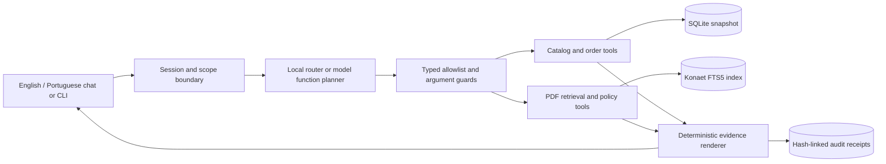

# Empório da Música · Konaet

A customer service agent for the fictional Empório da Música store, built for
the Artefact AI Engineer technical case by Adilson Oliveira.

**English is the default interface, response and submission language.** An
optional Portuguese interface and response mode supports the Brazilian store's
customers. All five submitted conversation examples and the project
documentation are in English.

**Public repository:** <https://github.com/7dsol3/emporio-musica-ai-agent>


## What it does

- Finds instruments by category, brand, model and BRL budget.
- Checks recorded stock and product lifecycle status before quoting availability.
- Shows original prices, active promotional discounts and final prices together.
- Calculates PIX and installment quotes without stacking prohibited discounts.
- Retrieves policy information from the supplied PDF with original page references.
- Asks for actual receipt details before evaluating an online return window.
- Protects order lookup with session verification and server-side ownership checks.
- Remembers product selections and return details during follow-up questions.
- Redirects unrelated requests and prepares human-support guidance for uncertainty.
- Runs as a web chat, a Python HTTP API, or a terminal application.

The data is a **supplied case snapshot**. A new tool query reads the database
again, but there is no live store, payment, carrier or ticketing connection.
The prototype does not execute purchases, reservations, refunds or support messages.

## Run the full local model demo on Windows

Requirements: Windows x64, Python 3.11 or 3.12, an internet connection for initial
setup, and at least 2 GiB free disk space for the optional inference assets.
A CPU is sufficient; no account, paid API key or GPU is required.

Double-click **`Run Demo.cmd`**, or run it from a terminal. On first use, it
creates a virtual environment, installs the application and downloads approximately
665 MB of pinned model/server assets from the official publishers. SHA-256
checks are required before loading them. The model cache is excluded from Git.

Open **<http://127.0.0.1:8000>**. The API reference is at
<http://127.0.0.1:8000/docs>. Stop the terminal with Ctrl+C when finished.

Equivalent commands:

```powershell
py -3 -m venv .venv
.\.venv\Scripts\python.exe -m pip install -e ".[dev]"
.\.venv\Scripts\python.exe scripts/local_model.py setup
.\.venv\Scripts\python.exe scripts/local_model.py app
```

The full demo uses **Qwen3-0.6B, Q8_0**, served locally through **llama.cpp**.
Qwen is an explicitly named external inference provider, not a model trained by
Konaet. Its role is bounded function selection; the application validates
arguments, enforces access and policy rules, and renders supported facts.

## Run without model weights

For the smallest reproducible demonstration, double-click `Run Offline.cmd`.
This mode uses the explicit Konaet local router and the same tools, storage,
policy retrieval and evidence renderer. It is deterministic and does **not** use
a neural language model. The interface and receipts identify the active mode.

On Windows, after installing as above:

```powershell
$env:EMPORIO_PROVIDER = "local"
.\.venv\Scripts\python.exe -m emporio serve
```

On Linux/macOS:

```bash
python3 -m venv .venv
source .venv/bin/activate
python -m pip install -e ".[dev]"
EMPORIO_PROVIDER=local python -m emporio serve
```

The pinned Windows model helper is platform specific. Other platforms can run
their own compatible inference server and configure the endpoint below.

## Use the terminal or inspect the data

```bash
python -m emporio chat --language en
python -m emporio chat --language pt
python -m emporio ingest
python -m emporio verify-audit
```

Terminal commands: `/verify` prompts for an order number and hides purchase email
entry; `/reset` deletes the current session; `/quit` exits. The CLI prints source
references after grounded answers. The web interface also offers an English / 
Portuguese selector, conversation export and a New conversation control.

## Connect another function-calling model

The model adapter uses an OpenAI-compatible **protocol**, independently of the
model vendor. Set the following environment variables before starting the app:

| Variable | Meaning |
| --- | --- |
| `EMPORIO_PROVIDER` | `local` (default), or `openai_compatible` |
| `EMPORIO_MODEL_URL` | Full `/v1/chat/completions` endpoint; HTTPS, or HTTP on loopback |
| `EMPORIO_MODEL` | Model ID accepted by that server |
| `EMPORIO_MODEL_KEY` | Optional bearer key, read only from the environment |
| `EMPORIO_MODEL_TIMEOUT` | Per-request timeout, 1-60 seconds; default 15 |
| `EMPORIO_DATA_DIR` | Optional directory containing the six original CSVs and PDF |
| `EMPORIO_STATE_DIR` | Optional local state directory; default `var/` |

The Windows helper sets a 45-second timeout for CPU inference. `.env.example`
documents the settings; `.env` files are not automatically loaded. Never commit
credentials. No unconfigured remote service is contacted by the application.

The backend must return native `tool_calls`. Free text, unknown functions,
extra fields or invalid arguments are rejected. A provider failure uses the
visible `local_fallback` mode. `tool_choice` is not treated as a security control;
the application validates what was actually returned.

## Architecture and technical choices



| Decision | Rationale |
| --- | --- |
| Python + FastAPI | Keeps the agent, CLI and API in one small implementation; typed boundaries and an OpenAPI schema make behavior inspectable. |
| Explicit orchestration | No agent framework is needed for seven bounded read-only tools. Execution limits and failure behavior remain visible in code. |
| Hybrid structured tools + lexical RAG | Prices, stock, promotions and private orders need structured queries; policies need document retrieval. Arbitrary model-generated SQL is unnecessary. |
| SQLite FTS5 | Eight policy pages do not justify a vector service or embedding-model download. Portuguese/English topic expansion bridges common terminology. |
| Frozen Konaet retrieval component | Reuses the existing project's page-aware indexing, BM25 retrieval and source hashes. It does not import the unrelated game or anti-cheat engines. |
| Small local model | Provides a reproducible function-calling path without paid credentials. Its limited language understanding is contained by validated tools and a local fallback. |
| Deterministic answer rendering | The model selects functions; prices, installment math and policy conclusions come from validated results. Free-form model claims are not rendered as facts. |
| SQLite session persistence | Enables selected-product and return-detail follow-ups across page refreshes with an explicit 24-hour expiry. |

The system prompt defines the store's friendly, practical persona, permitted
scope, source-of-truth rules, order boundaries and prohibition on inventing
receipt dates or completed transactions. It includes the current store-local
date and limited public context. A request permits one model planning round and
at most three tool calls; there is no unbounded ReAct loop.

The original PDF is parsed at startup into page-preserving chunks with a
1,200-character target and 180-character overlap. FTS5 retrieves relevant text;
reviewed English and Portuguese summaries provide concise customer language.
The executable rule layer handles monetary and date decisions. Summaries and
rules are pinned to the manual's SHA-256; a changed PDF fails startup until they
are reviewed. This prevents silently applying an old summary to a new manual.

For details, see [architecture](docs/ARCHITECTURE.md),
[data decisions](docs/DATA_DECISIONS.md), [validation](docs/VALIDATION.md) and
[component provenance](docs/PROVENANCE.md).

## Data handling and policy assumptions

The original six CSV files and policy PDF are preserved unchanged in `data/`.
Startup imports 65 products, 9 categories, 50 customer email records, 20 orders,
22 order items and 25 promotions. Four promotion rows are active in this snapshot.

- Monetary values use integer cents with explicit decimal rounding.
- Product status overrides a positive stock count for discontinued/coming-soon items.
- Only active promotion flags are used; no campaign date is invented.
- The highest active product discount is selected, without stacking.
- PIX gives 5% off list price only when no active promotional price applies.
- Detailed installment tiers take precedence over the manual's general table.
- Orders #3 and #20 have totals different from current catalog subtotals. The
  recorded totals are retained; current prices cannot reconstruct historical sales.
- Actual receipt is never inferred from order date, delivered status or an estimate.
- Exactly BRL 500 shipping, conflicting WhatsApp numbers and uncertain
  exchange/warranty cases are referred to the team.

Policy guidance describes the fictional supplied manual. It is not an
independent legal determination, and the application does not authorize or deny
refunds. Local/special holiday schedules require staff confirmation; the next
scheduled opening uses regular hours and the official 2026 national calendar.

## Order privacy and session boundaries

Use **Verify order** before requesting private order details. For evaluation,
the fictional fixture `order 8` and `anacarol.ferreira@coldmail.com` can be used.
That customer cannot access order 1. Knowing or supplying another customer ID
never grants access: the tool accepts no customer-ID argument, and SQL enforces
the verified session's owner on every lookup.

This order-number/email check is a **demo verification**, not production
authentication. A production deployment needs an account or one-time code,
HTTPS, secure cookies, central rate limits and a verified upstream identity.
The prototype binds only to loopback and rejects unexpected Host headers and
cross-origin writes. Verification is limited to five attempts/minute per client.

Only customer IDs and purchase emails are imported into the private customer
table; names, phone numbers and addresses are unnecessary for this service.
Recognizable email/phone patterns are redacted from chat before persistence or
model planning. Verification credentials, customer records, tool outputs and
assistant order-detail messages are not sent back to the model. The model sees
limited redacted user history and public product/return context. A redaction
pattern is not a general guarantee that arbitrary sensitive text will be recognized.

Sessions keep the latest 24 messages and expire after 24 hours; expiry cleanup
runs when sessions are accessed. New conversation deletes the active session.
Minimal audit receipts retain tool/source IDs and a hashed session ID, not raw
chat text. Hash chaining detects edits to an existing chain; without an external
anchor it does not prevent an operator from replacing or deleting the entire log.

## Validation and conversation examples

```bash
python -m pytest
python -m compileall -q emporio scripts
```

The suite covers business-rule boundaries, monetary rounding, snapshot rereads,
source references, order isolation, forged scope, verification throttling,
session reset, audit tampering, model-protocol validation, safe fallback, explicit
receipt facts and both response languages. The provider contract test uses a
clearly labeled local HTTP stub; separate live-model captures are included.

Five observed English conversations are in [examples/](examples/):

1. [Catalog search and installment follow-up](examples/01-catalog-and-installments.md)
2. [Active promotion and PIX nonstacking](examples/02-promotional-price.md)
3. [Return clarification and receipt window](examples/03-return-window.md)
4. [Verified order and cross-customer isolation](examples/04-private-order.md)
5. [Store information, unrelated request and injection attempt](examples/05-store-and-scope.md)

To recapture them from a running local model demo:

```bash
python scripts/capture_examples.py
```

Optional browser checks use an isolated test profile, not a personal browser:

```bash
python -m pip install playwright
python -m playwright install chromium
python scripts/check_ui.py
```

On Windows the check uses the installed Chrome channel; elsewhere it uses the
installed Playwright Chromium. Screenshots and the UI check report are in `docs/`.
The exact exercised environment is recorded in `requirements.lock`; it can be
installed with `python -m pip install -r requirements.lock` before the editable
project installation. Windows-specific dependencies are marked appropriately.

## Known limits and next steps

- This is a read-only prototype over a static dataset. Connect authenticated
  store/carrier APIs and record freshness before calling it live inventory.
- The small model and lexical router do not understand every paraphrase. The
  renderer is intentionally constrained; unsupported questions ask for clarity.
  A larger measured tool-calling model could improve recall without changing the tools.
- Policy summaries are manually reviewed, version-pinned representations. A
  new PDF requires explicit review and updated tests, not automatic rule extraction.
- No refund, complaint ticket, payment or reservation is actually created.
- SQLite and an application-wide turn lock prioritize local correctness over
  concurrent throughput. Multi-instance production needs a shared session store,
  transaction boundaries and distributed rate limits.
- The service retains a minimal local audit trail after session deletion and has
  no encrypted-at-rest storage or external audit anchor.
- The model setup helper targets Windows x64. Other platforms need their own
  compatible server binary. CPU latency depends on the machine.
- The 2026 national holiday list does not establish municipal or special store closures.

With more time, I would measure a broader bilingual paraphrase set, add upstream
authentication and service adapters, review every policy ambiguity with the
store, improve accessibility with user testing, and evaluate latency and tool
selection against a stronger local model under a fixed benchmark.

## Development assistance and provenance

OpenAI Codex was used as a coding assistant to inspect the supplied materials,
implement and revise application components, prepare documentation, run tests,
and capture example interactions. The workflow used incremental commits,
explicit failure corrections and reproducible checks. Generated suggestions
were checked against the case data and automated tests.

The project reuses a frozen Konaet retrieval module with its original license
and source hash. The anti-cheat and game research were references for evidence
boundaries, not language models for this store. See
[THIRD_PARTY_NOTICES.md](THIRD_PARTY_NOTICES.md) for the separate component and
model licenses. No training or inference result is presented as general proof
of accuracy, neural independence or production readiness.

## Troubleshooting

- **Python not found:** install Python 3.11+ and check `py -3 --version` on Windows.
- **Port 8000 busy:** stop the earlier demo, or use
  `python scripts/local_model.py app --port 8002` and open that port. Port 8081
  is reserved by the helper for its inference server.
- **Model download/checksum failure:** check connectivity and free disk space;
  rerun `setup`. A partial or mismatched download is never loaded.
- **Model backend exits:** inspect `var/model/server.log`. The deterministic
  demo remains available through `Run Offline.cmd`.
- **`local_fallback` in receipts:** the model returned invalid output or did not
  respond in time. The receipt identifies the local response path honestly.
- **No product matches:** try an exact model, a supplied brand, or another
  category/budget. The supplied fixture does not populate every possible category.
- **Policy hash changed:** update and review summaries, assumptions and tests
  before accepting the new manual; do not remove the version guard blindly.

## Submission

The Google Form requests a PDF generated from this README and project
documentation, plus the public GitHub URL in a separate field. The PDF build
script includes this README, architecture/data/validation/provenance notes and
the five actual English conversations. Preserve the committed revision at the
submission time and do not alter the repository after submission.

To rebuild the English PDF locally:

```bash
python -m pip install reportlab
python scripts/build_pdf.py
```

The result is written to `output/pdf/`, which is excluded from source control.
The build requires the recorded live evaluation and browser-check reports to
be present and successful.

This repository does not submit the form or send recruitment email automatically.
